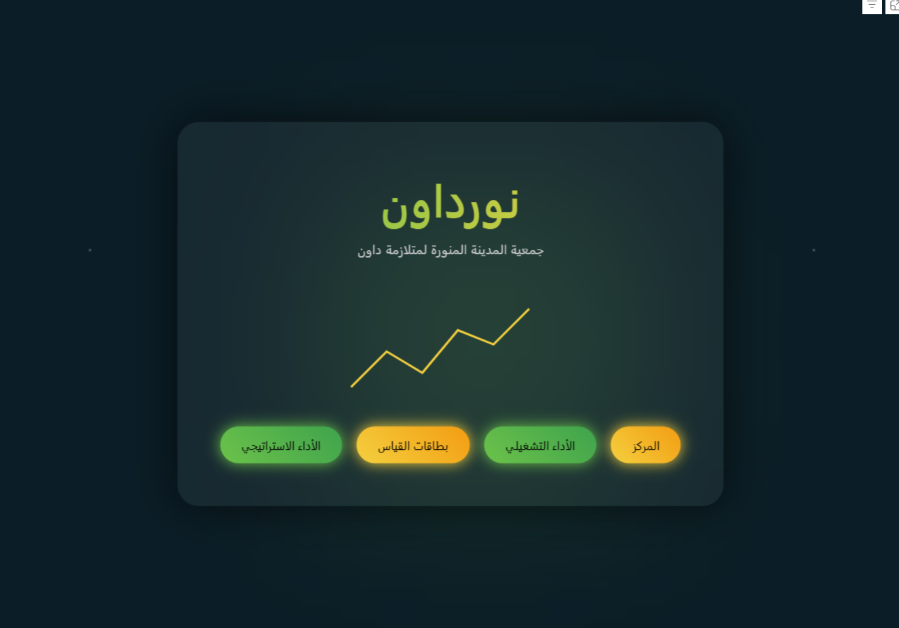
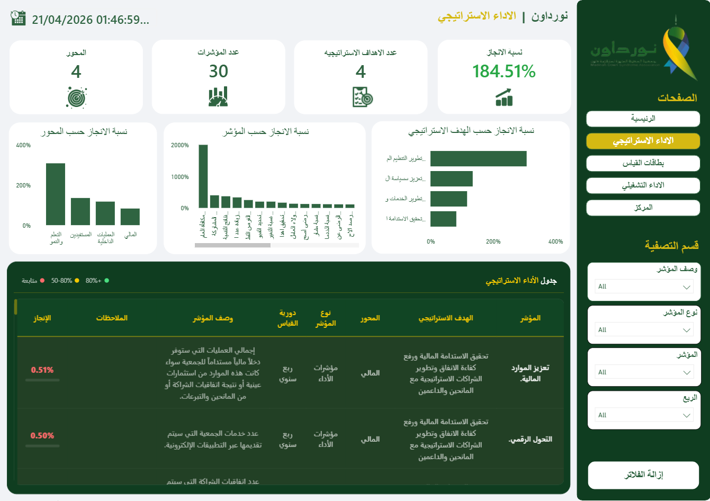
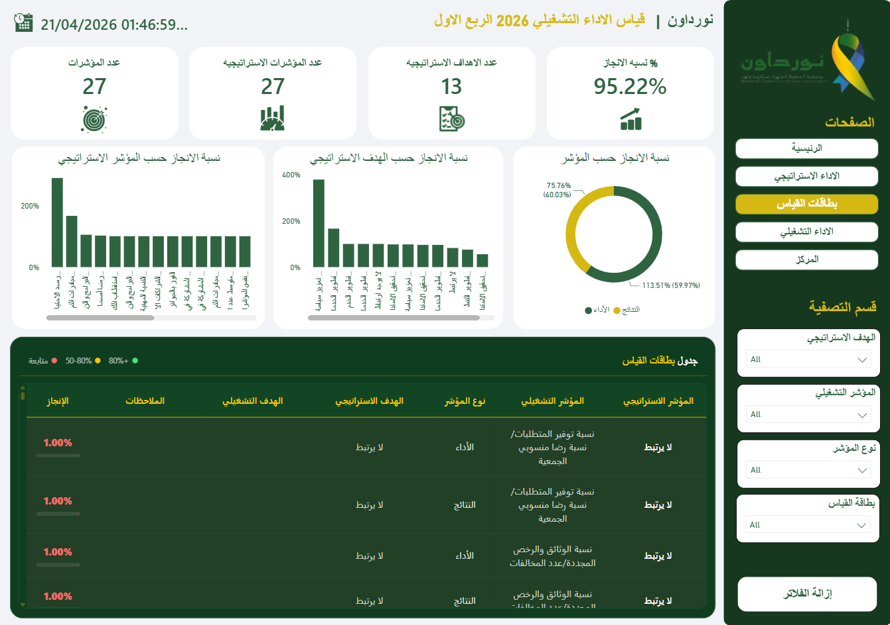
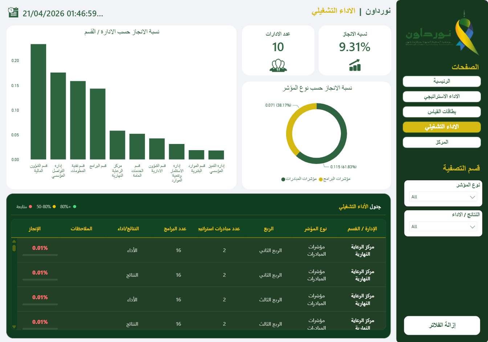
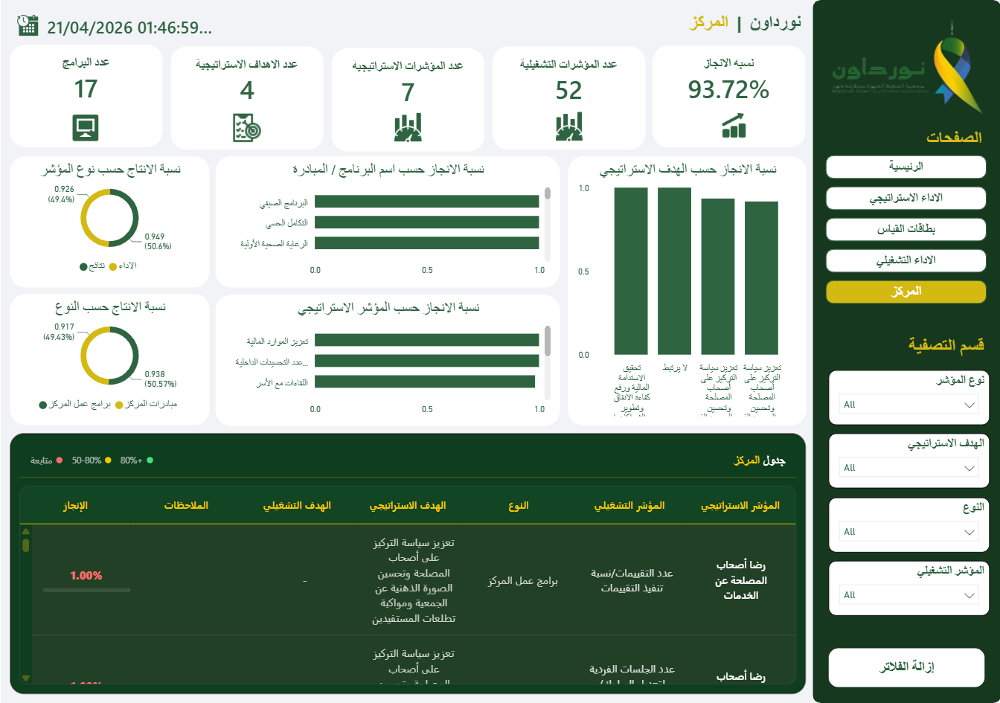

# Nour Down Association | Strategic & Operational Performance Power BI Dashboard 🟢 📊

An executive Data & Analytics dashboard developed for **Nour Down Association (جمعية المدينة المنورة لمتلازمة داون)** to measure, monitor, and evaluate strategic goals, operational performance, measurement scorecards, and department-level achievements.

---

## 🌟 Overview

This Power BI dashboard acts as a comprehensive Performance Management System (PMS) designed for organizational leadership, management teams, and decision-makers. It tracks high-level Strategic KPIs down to granular operational indicators across multiple departments and centers.

---

## 🖥️ Dashboard Structure & Key Pages

### 1. Landing Page (الرئيسية)
An interactive dark glassmorphic portal providing streamlined navigation to all core dashboard modules.

### 2. Strategic Performance (الأداء الاستراتيجي)
Focuses on organizational impact, long-term strategic objectives, and key performance drivers.
* **Key KPIs:** Overall Completion Rate (184.51%), Strategic Objectives (4), Total Indicators (30), Perspectives Count (4).
* **Visualizations:** Achievement by Perspective (Financial, Internal Processes, Beneficiaries, Learning & Growth) and detailed Strategy Execution Tables.

### 3. Scorecards & Measurement Cards (بطاقات القياس)
Dedicated to quarterly tracking (e.g., Q1 Operational Measurement) and performance distribution.
* **Key KPIs:** Operational Achievement Rate (95.22%), Strategic Goals (13), Strategic Indicators (27), Operational Indicators (27).
* **Visualizations:** Performance vs. Results breakdown chart, target progress distribution, and detailed indicator scorecards.

### 4. Operational Performance (الأداء التشغيلي)
Monitors internal department performance and operational efficiency across the organization.
* **Key KPIs:** Overall Operational Completion (9.31%), Total Departments (10).
* **Visualizations:** Departmental completion breakdown (Finance, Institutional Excellence, IT, Programs, Day Care Center, HR, etc.) and Initiative vs. Program indicator split.

### 5. Center Performance (المركز)
Tracks specialized programs, beneficiary services, and center-specific operational targets.
* **Key KPIs:** Center Achievement Rate (93.72%), Operational Indicators (52), Strategic Indicators (7), Strategic Goals (4), Program Count (17).
* **Visualizations:** Program completion breakdown (Summer Program, Sensory Integration, Primary Healthcare), indicator type distribution, and detailed activity tracking.

---

## 🛠️ Technical Stack & Design System

* **BI Tool:** Microsoft Power BI
* **UI/UX Theme:** Custom **Dark Green Glassmorphic Style** with smooth glowing accents, interactive sidebars, and tailored Arabic UI components.
* **Analytics Capabilities:** Dynamic Slicers (Indicator Types, Strategic Goals, Quarters, Departments), Custom Status Indicator Logic (Over-performing, On-track, Under-performing), and DAX Measures.

---

## 🔒 Confidentiality & NDA Note
> *Note: Due to organizational privacy and Non-Disclosure Agreements (NDA), the raw `.pbix` source file and underlying databases are strictly confidential and not included in this repository. Only UI/UX previews and documentation are presented.*
